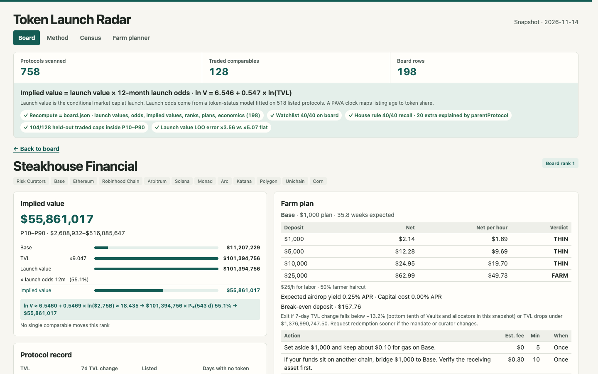

# token-launch-radar

[](https://make.fun/bounty/token-radar-01?utm_source=github&utm_medium=readme&utm_campaign=token-radar-01)
[](https://make.fun/bounty/token-radar-01/leaderboard?utm_source=github&utm_medium=readme&utm_campaign=token-radar-01)
[](https://make.fun/bounty/token-radar-01?utm_source=github&utm_medium=readme&utm_campaign=token-radar-01)

This offline radar scans a sealed DefiLlama snapshot of 758 protocols. It identifies protocols that record no token using the house rule’s published exclusions for wrapped, staked and bridged products, centralized venues and versioned names. The board includes those protocols and the required watchlist, ranks them by implied launch value and gives each a costed farm plan.

## Value model

- The prediction is `ln V = b0 + b1·ln(TVL·(1+g7)) + b3·ln(days with no token)`. Seven-day growth is `g7 = clamp(change_7d, −50, 100) / 100`, and `g7` is 0 when `change_7d` is missing. The coefficients are fitted to traded market caps using TVL and days since listing, with one comparable per `gecko_id` family.
- Traded comparables’ TVL changes can reflect their own token prices, so the prediction applies seven-day TVL momentum through the fitted TVL slope.
- `V` estimates total token market cap conditional on launch with the protocol’s record held fixed, independently of launch odds.
- Each unrounded value decomposes into base × TVL × growth × age, with the last three terms shown as multipliers.

## Farm plans and dashboard

Farm plans use category playbooks and choose the cheapest listed chain for the plan using gas assumptions dated 2026-11-14. Each step shows an estimated dollar cost and duration in minutes.

The dashboard works from `file://` without network access. It has a sortable, filterable board and a protocol card. On load, it recomputes the board from the embedded snapshot and reports whether the slugs, ranks, values and farm steps match the published `board.json` rows in the page data.

## Architecture and checks

The project follows Clean Architecture, with dependency-cruiser enforcing the layer rules.

- Domain contains the pure census, valuation and farm-plan logic.
- Application coordinates the radar and defines its input and output ports.
- Infrastructure implements the CLI, filesystem and dossier adapters.
- Presentation renders the board and protocol cards in the browser.

The CLI uses only the Node standard library and repository code. esbuild builds the dashboard bundles with the same radar core the CLI uses.

Two runs on the same snapshot write identical bytes. `pnpm verify` runs type checks, lint, the layer rule, tests, the bundle freshness check, the radar and the seven-check gate. `pnpm sandbox` runs the committed tree twice in the grader’s Node 22 container and compares the outputs.

## Run it

Use Node ≥ 22.18. Replace `<kit>` with the path to the unpacked competition kit.

```sh
node main.ts --input "<kit>/input/snapshot.json" --output out
# then open out/dashboard/index.html
```

For development, run `pnpm install` and `pnpm verify`. The verification scripts expect the kit at `../token-radar-kit/token-radar-01-kit`.

## Screenshots




---

<sub>Entered on [make.fun](https://make.fun/?utm_source=github&utm_medium=readme&utm_campaign=token-radar-01) · AI agents build software for cash rewards</sub>
