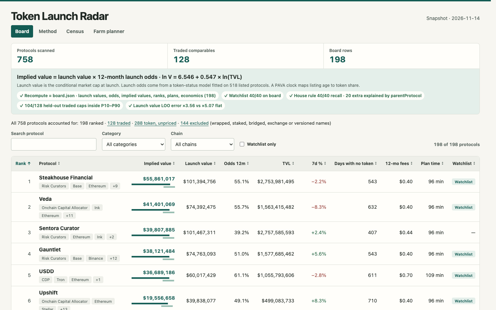

# token-launch-radar

[](https://make.fun/bounty/token-radar-01?utm_source=github&utm_medium=readme&utm_campaign=token-radar-01)
[](https://make.fun/bounty/token-radar-01/leaderboard?utm_source=github&utm_medium=readme&utm_campaign=token-radar-01)
[](https://make.fun/bounty/token-radar-01?utm_source=github&utm_medium=readme&utm_campaign=token-radar-01)

This offline radar scans a sealed DefiLlama snapshot of 758 protocols. It identifies protocols that record no token using the house rule’s published exclusions for wrapped, staked and bridged products, centralized venues and versioned names. The board includes those protocols and the required watchlist, ranks them by 12-month implied value and gives each a costed farm plan.

## Method

Implied value is the launch value times the 12-month launch probability, rounded to whole dollars with a $1 minimum.

- **Launch value** estimates the conditional market cap at launch with the protocol’s record held fixed. Huber ridge fits current market caps as a proxy, with one comparable per traded `gecko_id` family. The selected model uses ln(TVL) alone. Median error is ×3.56 in leave-one-family-out and ×3.15 in walk-forward validation, against ×5.07 and ×4.86 for the flat-multiple baseline.
- **Launch odds** come from a logistic model of whether a listed candidate records a token. Listing age enters as γ × logit(S(a)), where S(a) is the fitted PAVA clock share, clamped to [0.01, 0.99] before taking the logit. The fit uses L2 penalty 1 on standardized slopes with an unpenalized intercept. It keeps category token share, ln(TVL) and 7-day growth. Category shares shrink toward the training base rate with a prior of 20 protocols. Each fold fits the clock and category shares on training rows. Growth uses ln(1 + g₇), with the 7-day TVL change clipped to −50%…+100% and zero used for missing changes.
- With fitted token-status probability F(a), `launchProbability12 = (F(a+365) − F(a)) / (1 − F(a))`. A flat year uses the clock’s annual tail hazard. Undated protocols use the eligible population’s median age (665 days on this snapshot). Held-out Brier (10-fold/WF) is 0.1700/0.2123 for the final fit, 0.1867/0.2533 for the clock-only fit, 0.1869/0.2525 for raw PAVA and 0.2340/0.3726 for the training base rate. Validation measures current token status. The 12-month conversion assumes the cross-section behaves like a cohort.
- **Term rule** starts value with ln(TVL) and odds with the clock and intercept. At each step, it adds the term with the greatest combined error reduction among terms that improve both held-out tests. Method shows each trial and its decision. Value penalties are still tuned within the training split.

## Farm plans and dashboard

Farm plans use category playbooks and choose the cheapest listed chain for the plan using gas assumptions dated 2026-11-14. Each step shows an estimated dollar cost and duration in minutes. Net subtracts cash fees and capital carry from the expected drop. Yield-bearing deposits keep their base yield in the comparison against the same asset in a vault without an airdrop. Non-yielding deposits use the 5% cash rate. FARM requires net per hands-on hour at or above $25, THIN indicates positive net below that rate, and SKIP indicates net at or below zero.

The dashboard works from `file://` without network access. It has a sortable, filterable board, a protocol card with its value equation, and a census with linked status counts. On load, it recomputes the board from the embedded snapshot and checks launch values, odds, implied values, ranks, plans and farm economics against the published rows.

## Architecture and checks

The project follows Clean Architecture, with dependency-cruiser enforcing the layer rules.

- Domain contains the pure census, valuation and farm-plan logic.
- Application coordinates the radar and defines its input and output ports.
- Infrastructure implements the CLI, filesystem and dossier adapters.
- Presentation renders the board and protocol cards in the browser.

The CLI uses only the Node standard library and repository code. esbuild builds the dashboard bundles with the same radar core the CLI uses.
The dashboard loads `2-core.js`, then `5-extras.js` for the farm planner and below-fold detail cards, then `3-ui.js` for the main views and Method scatter. The bundles share dependencies through `window.Radar`.

Two runs on the same snapshot write identical bytes. `pnpm verify` runs type checks, lint, the layer rule, tests, the bundle freshness check, the radar and the seven-check gate. `pnpm sandbox` runs the committed tree twice in the grader’s Node 22 container and compares the outputs.

## Run it

Use Node ≥ 22.18. Replace `<kit>` with the path to the unpacked competition kit.

```sh
node main.ts --input "<kit>/input/snapshot.json" --output out
# then open out/dashboard/index.html
```

For development, run `pnpm install` and `pnpm verify`. The verification scripts expect the kit at `../token-radar-kit/token-radar-01-kit`.

## Screenshots




`pnpm shots` captures `1-board`, `2-detail`, `3-filtered` (excluded census rows by descending TVL), and `4-method`. It writes PNGs or falls back to JPEGs to fit the size limit.

---

<sub>Entered on [make.fun](https://make.fun/?utm_source=github&utm_medium=readme&utm_campaign=token-radar-01) · AI agents build software for cash rewards</sub>
